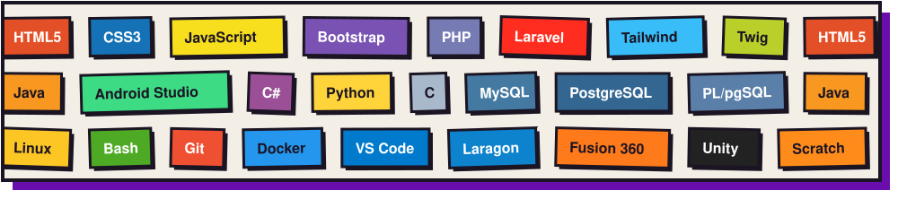

<!-- Remplace "Nailt" par ton pseudo GitHub dans les URLs de stats si besoin -->

  

  

  
  
  
  

  

  <i>Actuellement en BUT Informatique (3e année) au Havre. 
  Apprenti chez <b>IES Ingénierie</b> (Port-Jérôme-sur-Seine) pour l'année 2026/2027.</i>

  

  

<table align="center">
  <tr>
    <td>🌐 <b>Web</b></td>
    <td><code>HTML5</code> <code>CSS3</code> <code>JavaScript</code> <code>Bootstrap</code> <code>PHP</code> <code>Laravel</code> <code>Tailwind</code> <code>Twig</code></td>
  </tr>
  <tr>
    <td>🗄️ <b>Bases de données</b></td>
    <td><code>MySQL</code> <code>PostgreSQL</code> <code>PlpgSql</code></td>
  </tr>
  <tr>
    <td>☕ <b>Applicatif &amp; Mobile</b></td>
    <td><code>Java</code> <code>Android Studio</code> <code>C#</code> <code>Python</code> <code>C</code></td>
  </tr>
  <tr>
    <td>🛠️ <b>Système &amp; Outils</b></td>
    <td><code>Linux</code> <code>Git</code> <code>Docker</code> <code>Bash</code> <code>VS Code</code> <code>Laragon</code></td>
  </tr>
  <tr>
    <td>🎨 <b>Création &amp; Modélisation</b></td>
    <td><code>Fusion 360</code> <code>Unity</code> <code>Scratch</code></td>
  </tr>
</table>

  
  

  

  

  <picture>
    <source media="(prefers-color-scheme: dark)" srcset="https://raw.githubusercontent.com/Nailt/Nailt/output/github-snake-dark.svg" />
    <source media="(prefers-color-scheme: light)" srcset="https://raw.githubusercontent.com/Nailt/Nailt/output/github-snake.svg" />
    
  </picture>

  
  &nbsp;
  

  

