<picture>
  <source media="(prefers-color-scheme: dark)" srcset="./assets/sombre/header.svg">
  
</picture>

<picture>
  <source media="(prefers-color-scheme: dark)" srcset="./assets/sombre/typing.svg">
  
</picture>

 

<picture>
  <source media="(prefers-color-scheme: dark)" srcset="./assets/sombre/title-apropos.svg">
  
</picture>

<picture>
  <source media="(prefers-color-scheme: dark)" srcset="./assets/sombre/fiche.svg">
  
</picture>

 

<picture>
  <source media="(prefers-color-scheme: dark)" srcset="./assets/sombre/title-parcours.svg">
  
</picture>

<picture>
  <source media="(prefers-color-scheme: dark)" srcset="./assets/sombre/parcours.svg">
  
</picture>

 

<picture>
  <source media="(prefers-color-scheme: dark)" srcset="./assets/sombre/title-projets.svg">
  
</picture>

<a href="https://github.com/Nailledo/Calculatrice">
  <picture>
    <source media="(prefers-color-scheme: dark)" srcset="./assets/sombre/projet-calculatrice.svg">
    
  </picture>
</a>

<a href="https://github.com/Nailledo/Calculatrice">
  <picture>
    <source media="(prefers-color-scheme: dark)" srcset="./assets/sombre/btn-code.svg">
    
  </picture>
</a>

  

<a href="https://github.com/Nailledo/Outil-de-Retroconception-Java-UML">
  <picture>
    <source media="(prefers-color-scheme: dark)" srcset="./assets/sombre/projet-retroconception.svg">
    
  </picture>
</a>

<a href="https://github.com/Nailledo/Outil-de-Retroconception-Java-UML">
  <picture>
    <source media="(prefers-color-scheme: dark)" srcset="./assets/sombre/btn-code.svg">
    
  </picture>
</a>
&nbsp;
<a href="https://github.com/Nailledo?tab=repositories">
  <picture>
    <source media="(prefers-color-scheme: dark)" srcset="./assets/sombre/btn-repos.svg">
    
  </picture>
</a>

  

<picture>
  <source media="(prefers-color-scheme: dark)" srcset="./assets/sombre/title-stack.svg">
  
</picture>

<picture>
  <source media="(prefers-color-scheme: dark)" srcset="./assets/sombre/stack.svg">
  
</picture>

<b>Détail des compétences</b>

 

| Domaine | Technologies | Usage |
|---|---|---|
| **Web** | HTML5 · CSS3 · JavaScript · PHP · Laravel · Twig · Bootstrap · Tailwind | Sites et applications web, du front au back |
| **Bases de données** | MySQL · PostgreSQL · PL/pgSQL | Modélisation, requêtes et procédures stockées |
| **Applicatif & mobile** | Java (Swing) · Android Studio · C# · Python · C | Programmation objet, applications de bureau et Android |
| **Système & outils** | Linux · Bash · Docker · Git · VS Code · Laragon | Environnement de dev, déploiement et versionnage |
| **Création & 3D** | Fusion 360 · Unity · Scratch | Modélisation 3D et prototypes de jeux |

 

<picture>
  <source media="(prefers-color-scheme: dark)" srcset="./assets/sombre/title-contact.svg">
  
</picture>

<a href="mailto:jonathan10leclerc@gmail.com">
  <picture>
    <source media="(prefers-color-scheme: dark)" srcset="./assets/sombre/btn-email.svg">
    
  </picture>
</a>
&nbsp;
<a href="https://www.linkedin.com/in/jonathanleclerc2006/">
  <picture>
    <source media="(prefers-color-scheme: dark)" srcset="./assets/sombre/btn-linkedin.svg">
    
  </picture>
</a>

  

<picture>
  <source media="(prefers-color-scheme: dark)" srcset="./assets/sombre/footer.svg">
  
</picture>
